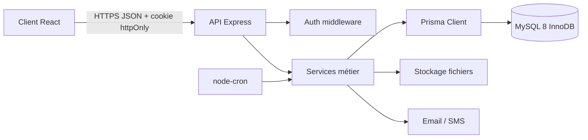

# Architecture technique InnovCom

## 1. Vue d'ensemble

InnovCom est un monorepo en deux applications :

- `client/` : SPA React + Vite, responsive mobile-first pour agents et administrateurs.
- `server/` : API REST Node.js + Express, organisée en routes, contrôleurs, services et accès Prisma.
- MySQL 8/InnoDB : source transactionnelle des comptes, rapports, opérations financières et journaux.
- Stockage fichiers : abstraction compatible disque local en développement et S3 en production.
- Email/SMS : adaptateurs séparés, afin que les services métier restent indépendants du fournisseur.



## 2. Organisation du serveur

```text
server/src/
  app.ts                 # création Express et middlewares
  index.ts               # démarrage HTTP
  config/                # environnement et paramètres
  routes/                # déclaration des endpoints
  controllers/           # HTTP: validation, codes, sérialisation
  services/              # règles métier et transactions
  repositories/           # accès Prisma, requêtes spécialisées
  middlewares/           # auth, rôles, propriété, erreurs, rate limit
  schemas/               # schémas Zod d'entrée
  jobs/                  # nettoyage tokens, rappels
  lib/                   # Prisma, logger, stockage, mail
```

Les contrôleurs ne calculent pas de solde et ne changent pas directement les statuts. Ces opérations appartiennent aux services métier, appelés dans des transactions Prisma.

## 3. Domaines et responsabilités

| Domaine | Responsabilité | Tables principales |
| --- | --- | --- |
| Authentification | Connexion, activation, reset, refresh, rôles | `users`, `activation_tokens`, `refresh_tokens` |
| Candidatures | Réception publique et décision admin | `applications` |
| Profils | Identité agent, CIN et mobile money | `agent_profiles` |
| Catalogue | Produits et fichiers publiés | `products`, `product_files` |
| Prospection | Création, soumission, revue et historique | `reports`, `report_attachments`, `report_status_history` |
| Finance | Gains immuables, retraits bloqués et paiement | `transactions`, `withdrawals`, `settings` |
| Communauté | Catégories, publications, commentaires, likes, signalements | `post_categories`, `posts`, `comments`, `post_likes`, `content_reports` |
| Notifications | Alertes in-app et relais email/SMS | `notifications` |
| Audit | Traçabilité des actions sensibles | `audit_logs` |

## 4. Flux de données critiques

### Validation d'un rapport

1. Le service charge le rapport et verrouille la ligne agent avec `SELECT ... FOR UPDATE`.
2. Il vérifie que le rapport est dans un état autorisant `VALIDE`.
3. Il lit le montant courant dans `settings`.
4. Il change le statut, crée l'entrée `report_status_history` et crée une transaction `GAIN_RAPPORT` positive.
5. L'unicité de `transactions.report_id` empêche un second gain pour le même rapport.
6. L'action admin est ajoutée dans `audit_logs` et une notification est créée.

Tout ce flux est une seule transaction SQL.

### Demande de retrait

1. Le service verrouille l'agent et calcule les gains moins les retraits `DEMANDE`, `APPROUVE` et `PAYE`.
2. Il vérifie le minimum configuré et la disponibilité.
3. Il vérifie l'absence d'un autre retrait `DEMANDE` ou `APPROUVE`.
4. Il crée le retrait `DEMANDE`, ce qui bloque immédiatement le montant.

Un refus libère le montant car seuls les retraits actifs sont inclus dans le calcul du solde.

### Détection de doublons

À la soumission, le service normalise le nom d'entreprise et recherche, sur les 90 derniers jours configurés, un rapport d'un autre agent correspondant au nom normalisé ou au téléphone. Le résultat met `is_duplicate_flag` à `true` mais ne bloque pas la soumission.

## 5. Règles d'accès

- Les routes `/admin/*` exigent `ADMIN` ou `SUPER_ADMIN`.
- Un agent ne peut lire ou modifier que ses rapports, son portefeuille, son profil et ses notifications.
- Un rapport `VALIDE` ou `REJETE` est immuable côté agent.
- Les motifs de rejet et de refus sont obligatoires.
- Les fichiers sont vérifiés par taille, MIME et extension, puis renommés avant stockage.
- Les refresh tokens sont stockés sous forme de hash et transmis uniquement via cookie `httpOnly`, `Secure` en production, avec politique CSRF dédiée.

## 6. API par modules

```text
/api/public/applications
/api/auth/*
/api/me
/api/products
/api/reports
/api/wallet
/api/withdrawals
/api/stats/agent
/api/posts
/api/notifications
/api/admin/applications
/api/admin/agents
/api/admin/reports
/api/admin/withdrawals
/api/admin/products
/api/admin/posts
/api/admin/settings
/api/admin/export
```

Les entrées HTTP sont validées par Zod. La pagination est systématique avec `page` et `limit`, et les erreurs sont renvoyées dans un format commun :

```json
{
  "error": {
    "code": "VALIDATION_ERROR",
    "message": "Les données envoyées sont invalides",
    "details": []
  }
}
```

## 7. Déploiement cible

- Nginx termine TLS et route `/api` vers le serveur Express.
- Le client React est servi comme fichiers statiques ou via CDN.
- Le serveur Express tourne en conteneur non privilégié.
- MySQL est isolé sur un réseau privé, avec sauvegardes chiffrées quotidiennes et test de restauration.
- Les logs structurés contiennent un identifiant de requête, sans mot de passe, token ou données sensibles.
- Les secrets sont fournis par l'environnement de déploiement, jamais versionnés.

## 8. Décisions de modélisation

- Les montants sont des `BIGINT` en Ariary entiers, jamais des flottants.
- Les transactions financières sont append-only : une correction est un nouvel `AJUSTEMENT`.
- `transactions.report_id` est unique pour rendre le gain d'un rapport idempotent.
- Les historiques et audits sont séparés : l'historique décrit le cycle d'un rapport, l'audit décrit l'action de l'utilisateur.
- Le ciblage des signalements de contenu utilise `target_type` + `target_id`, car les cibles sont des posts ou des commentaires.
- Les paramètres métier comme le gain par rapport, le minimum de retrait et la fenêtre de doublon sont externalisés dans `settings`.
